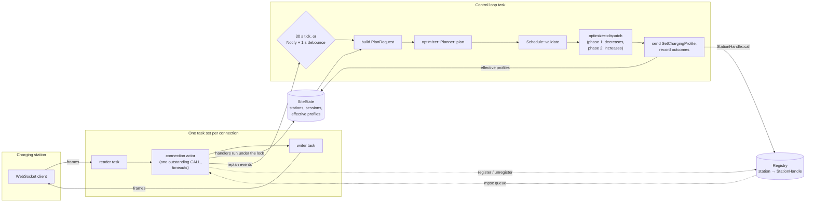
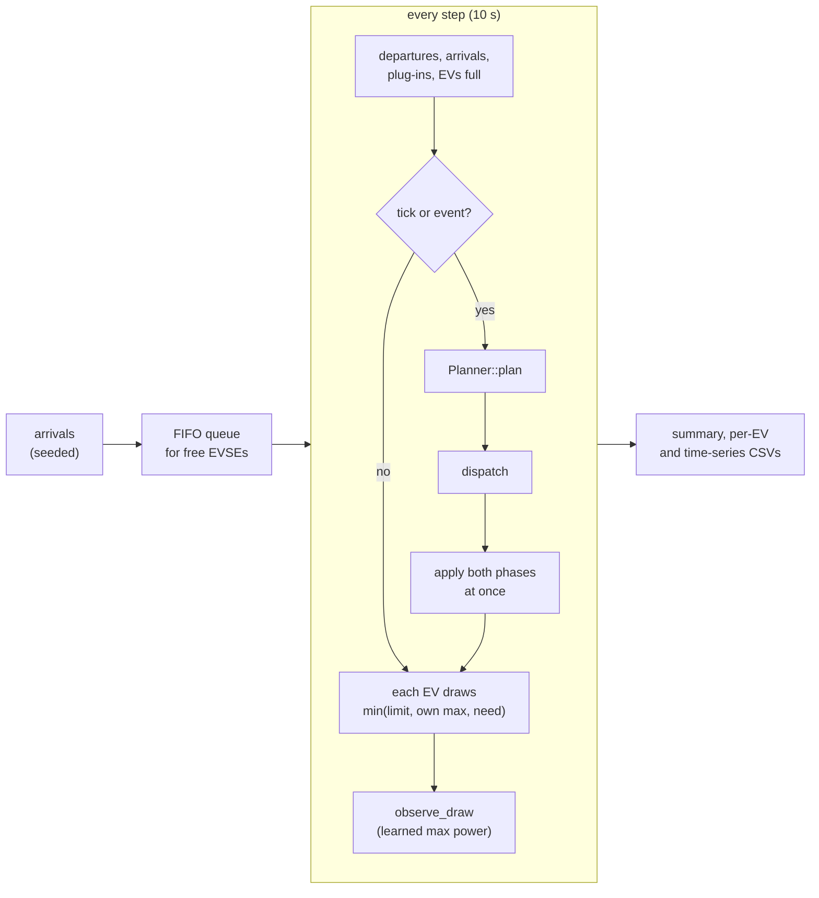

# Architecture

How the pieces fit at runtime. The OCPP details (supported messages, profile conventions,
defaults) are in [ocpp-subset.md](ocpp-subset.md); the scheduling model is in the
[README](../README.md#the-optimizer).

## Crates

| Crate | Depends on | Role |
|---|---|---|
| `ocpp` | — | OCPP-J framing (`Frame`), error codes, and the OCPP 2.0.1 message types used here. No IO. |
| `optimizer` | — | Schedulers, the receding-horizon `Planner`, needs estimation, and `dispatch`, which turns a plan into profile updates. Pure: no IO, no async, no clock. |
| `csms` | `ocpp`, `optimizer` | The server: WebSocket endpoint, one actor per station connection, the site state, and the control loop. |
| `simulator` | `optimizer` | The `sim offline` binary: a simulated site that runs the same planner and dispatch as the CSMS. |

Every decision about power lives in `optimizer`, which never touches a socket or a clock:
time comes in as an argument. So:

- the property tests and the benchmark exercise exactly the logic the CSMS runs;
- the CSMS only gathers the inputs, calls the optimizer, and carries out the result over
  OCPP;
- an offline run of a week takes seconds, because nothing waits for real time.

## The CSMS at runtime

**Connections** (`ws.rs`, `connection.rs`). `GET /ocpp/{stationId}` upgrades to a
WebSocket. A station that doesn't offer the `ocpp2.0.1` subprotocol is closed right away,
with code 1002. Each accepted connection gets three tasks:

- a **reader** that forwards text frames;
- a **writer** that sends them;
- the **actor** between the two, which owns everything about the connection.

The actor parses each frame. It runs a station CALL through the handlers and replies, and it
matches CALLRESULTs and CALLERRORs to the CALL the CSMS has outstanding.

**Registry** (`registry.rs`). It maps each connected station to a `StationHandle`: a clonable
sender into that actor's queue of outbound CALLs. A station that reconnects replaces its old
connection, which is told to stop. A generation counter makes sure the old connection, as it
shuts down, doesn't unregister the new one.

**Site state** (`state.rs`). One `SiteState` behind a `std::sync::Mutex` holds what the
stations reported: stations and their EVSEs, sessions with meter readings and needs, and
each EVSE's *effective* profile, the one the CSMS believes it follows. The handlers are
plain synchronous functions (`handlers.rs`, `transactions.rs`, `charging_needs.rs`) that
take `&mut SiteState`, so they are unit-tested without sockets. The lock is never held
across an `.await`.

**Control loop** (`control.rs`). One task wakes every 30 s, or 1 s after a handler signals a
`Notify` (a session starts or ends, needs arrive, an EV pauses or resumes, a new EVSE is
reported, a station disconnects or refuses its TxDefaultProfile). The 1 s debounce turns a burst of
events into one plan. Each tick:

1. builds a `PlanRequest` under the lock: sessions on connected stations become scheduler
   inputs, with needs reported or assumed (`optimizer::SessionState::request`); paused EVs
   are held at the fallback limit; idle EVSEs and sessions on disconnected stations reserve
   capacity;
2. calls `Planner::plan` and checks the schedule with `Schedule::validate`, sending nothing
   if it fails;
3. calls `optimizer::dispatch`, which compares the plan with the effective profiles, drops
   changes below the threshold, and splits the rest into two phases;
4. sends phase 1 concurrently, then phase 2, recording each outcome in the effective
   profiles.

**Outbound CALLs** (`handle.rs`, `connection.rs`). `StationHandle::call` queues a request
with a `oneshot` for the reply. The actor sends a queued CALL only when none is
outstanding, as OCPP-J requires. The timeout (30 s) starts when the CALL is sent, not when
it is queued. A timeout, a CALLERROR, an undecodable reply or a lost connection each come
back to the caller as a distinct `CallError`.

## The offline simulator

`simulator::engine::run` replaces the stations and the network with a loop over fixed steps.
It builds the same `SessionState`s and `PlanRequest`, calls the same `Planner`, `dispatch`
and `observe_draw`, and applies every update at once: a simulated station always accepts.
EVs that don't report their needs get the same site defaults as on the CSMS, so the
benchmark measures the cost of missing information too. A run fails if the site draws more
than its grid limit at any step.

## Staying within the grid limit

The limit must hold not just in each plan but at every moment, while stations accept
profiles in any order, and with EVs plugging in between two plans. The mechanisms, each
with the tests that back it:

| Risk | Mechanism | Tests |
|---|---|---|
| An EV plugs in before the next plan | Every EVSE gets a TxDefaultProfile at the fallback limit on boot, and the planner keeps that much free for every idle EVSE | `control.rs` `a_new_session_runs_on_the_fallback_until_its_first_plan` |
| A station refuses its TxDefaultProfile | Its EVSEs count at full rating until they get a TxProfile | `control.rs` `stations_without_a_tx_default_profile_are_reserved_at_full_rating` |
| Stations accept updates in any order | Two phases: pure decreases first, increases once all are accepted, so any interleaving stays below the old or the new total | `optimizer` `control.rs` tests, `control.rs` `a_rejected_decrease_holds_back_the_increases` |
| A decrease is refused | The EVSE keeps its old profile; increases elsewhere go out only if they fit with it | `increases_that_fit_go_out_despite_a_rejected_decrease` |
| An update goes unanswered | The EVSE counts at the higher of old and new until a later profile is accepted | `an_unanswered_profile_counts_at_the_higher_limit` |
| A station disconnects | Its sessions can't be steered: their highest future limit is reserved | `sessions_on_disconnected_stations_are_reserved` |
| Small changes held back by the threshold add up | If holding them back would exceed the limit, every change is sent | `optimizer` `held_back_changes_are_sent_when_the_total_would_overshoot` |
| All of it together | A model of the stations checks the sum of the limits they follow after every step | `control.rs` `the_grid_limit_holds_as_evs_come_and_go`, `simulator` `the_limit_holds_for_every_strategy` |

The one known gap is described in [ocpp-subset.md](ocpp-subset.md#control-loop): an EV
throttled below the fallback limit that leaves returns its EVSE to the fallback about 1 s
before the next plan makes room for it.

## Time

- **Slots.** Planning time is split into slots of fixed length (5 min in the CSMS by
  default), numbered from the Unix epoch: slot `floor(t / Δ)`. The current slot counts as a
  full slot even when `now` falls inside it.
- **Departures.** A departure at `d` gives the exclusive end slot `floor(d / Δ)`. That leaves
  out a final partial slot, so the plan never counts on power after the EV has gone. It is
  never before the end of the current slot: an EV still plugged in can always charge now.
- **Profiles.** Each profile starts at the planning time, with periods at slot boundaries,
  and ends with 0 W at the departure when that falls within the horizon.
- **Clock.** The CSMS reads time from a `Clock` that follows the tokio clock, so tests run
  hours of control loop in milliseconds with paused time. The optimizer takes `now` as an
  argument.
