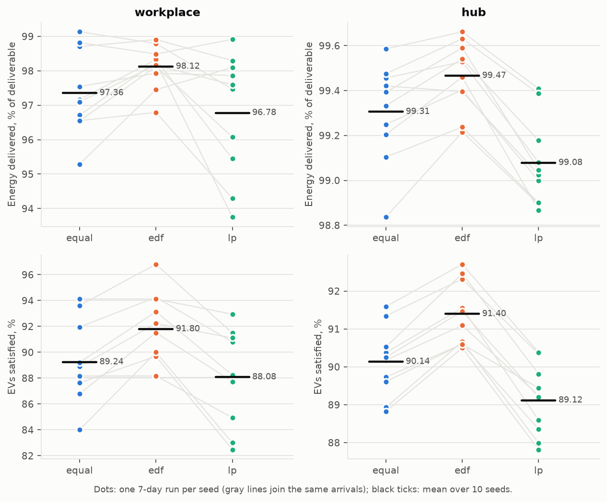
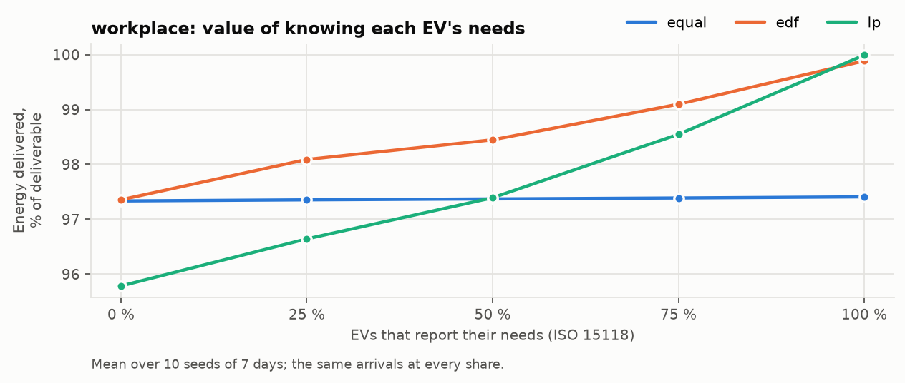
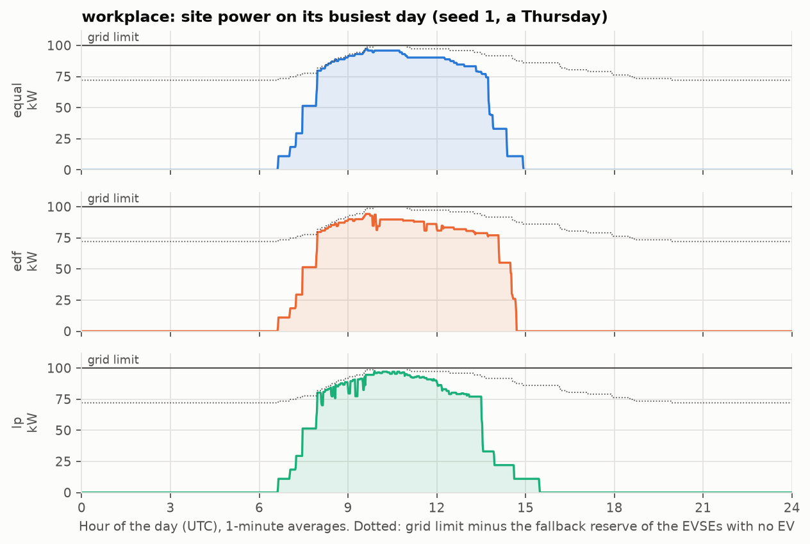
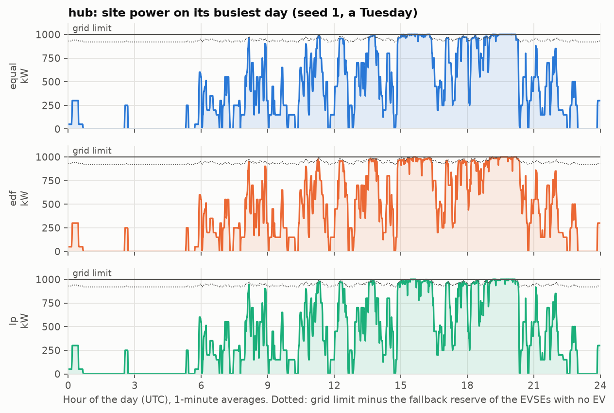
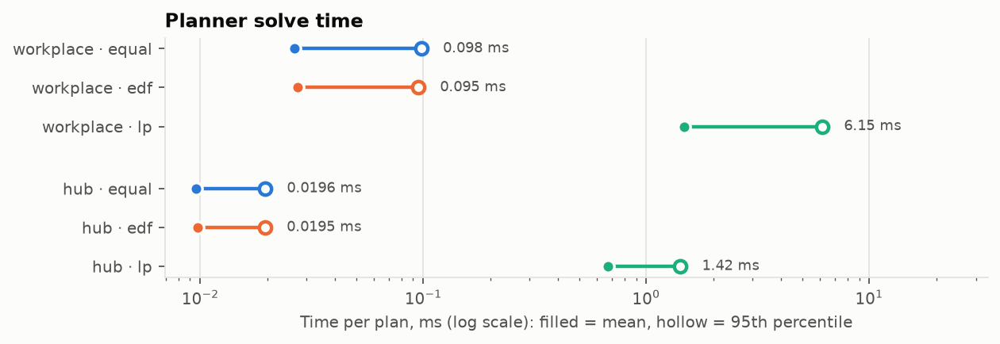

# Benchmark: equal share, EDF and LP

This compares the three schedulers on the two preset sites, in the offline simulator. The
simulator runs the same planner, needs estimation and profile dispatch as the CSMS (see the
[README](../README.md#running-the-simulator)), so what is measured here is the control
logic that runs live, not a separate model of it.

**In short:** EDF delivers the most energy and satisfies the most drivers on both sites,
with the fewest profile messages. The LP, although optimal for each snapshot it plans, comes
last: it only pulls ahead when every EV reports its needs. Its edge depends on accurate
information, and most EVs today don't report any.

## Setup

- **Scenarios:** the two presets in [`config/scenarios/`](../config/scenarios/):
  - `workplace`: 20 AC EVSEs of 22 kW behind a 100 kW grid limit. EVs arrive mostly between
    7 and 9 on weekdays (a few on weekends) and stay about 8 h.
  - `hub`: 8 DC outlets of 300 kW behind a 1 MW limit. EVs arrive all day, stay 15 to
    45 min and leave as soon as they are full. Drivers queue for a free outlet, and give up
    after 10 min.
- **Information:** 30 % (`workplace`) and 50 % (`hub`) of the EVs report their departure,
  energy and max power (ISO 15118). For the others, the CSMS assumes the site's defaults (an
  8 h stay and 20 kWh at `workplace`, 30 min and 40 kWh at `hub`) and learns their max power
  from meter values.
- **Runs:** 10 seeds × 7 days of arrivals (Monday to Sunday) for each scenario and
  scheduler, 60 runs in all. A seed fixes the arrivals, so the three schedulers of one seed
  see the same EVs. Each run continues until the last EV has left.
- **Score:** energy delivered as a share of *deliverable* energy. Deliverable energy is what
  the EV could have taken at its max power for as long as it was plugged in, capped by what
  its driver asked for. No scheduler can beat it, so it scores the scheduler, not the site.
  Also: *satisfied* EVs, which left with all the energy they asked for; drivers who *gave
  up* waiting for an outlet; and `SetChargingProfile` messages sent.

To reproduce (about 15 s on 22 cores):

```sh
scripts/benchmark.sh                  # writes docs/benchmark/summary.csv and voi.csv
python3 -m venv .venv && .venv/bin/pip install -r scripts/requirements.txt
.venv/bin/python scripts/plot.py      # draws the charts, prints the tables below
```

Every run is deterministic. A rerun gives the same CSVs, except for the solve times.

## Results



Mean ± standard deviation over the 10 seeds:

| Scenario | Scheduler | Delivered, % of deliverable | EVs satisfied, % | Gave up waiting | Profiles sent | Mean plan time |
|---|---|---|---|---|---|---|
| workplace | equal | 97.36 ± 1.21 | 89.2 ± 3.1 | 1.9 | 6,682 | 0.027 ms |
| workplace | edf | **98.12** ± 0.63 | **91.8** ± 2.9 | 1.9 | 4,872 | 0.027 ms |
| workplace | lp | 96.78 ± 1.78 | 88.1 ± 3.6 | 1.9 | 7,262 | 1.474 ms |
| hub | equal | 99.31 ± 0.22 | 90.1 ± 0.9 | 4.4 | 26,934 | 0.010 ms |
| hub | edf | **99.47** ± 0.15 | **91.4** ± 0.8 | 2.8 | 23,239 | 0.010 ms |
| hub | lp | 99.08 ± 0.19 | 89.1 ± 0.9 | 9.0 | 29,594 | 0.672 ms |

The spread between seeds is larger than most differences between schedulers: some weeks
are simply busier. Since the schedulers of one seed see the same arrivals, the fair
comparison is seed by seed. Paired differences in delivered energy, in percentage points:

| Scenario | Difference | Mean, pp | Lowest seed | Highest seed | Seeds where the first is ahead |
|---|---|---|---|---|---|
| workplace | edf − equal | +0.77 | -0.34 | +2.16 | 8 of 10 |
| workplace | lp − edf | -1.34 | -4.51 | +0.65 | 2 of 10 |
| workplace | lp − equal | -0.58 | -2.96 | +2.81 | 4 of 10 |
| hub | edf − equal | +0.16 | -0.03 | +0.38 | 9 of 10 |
| hub | lp − edf | -0.39 | -0.59 | -0.24 | 0 of 10 |
| hub | lp − equal | -0.23 | -0.40 | +0.06 | 1 of 10 |

The ordering is consistent: EDF beats equal share on 17 of 20 seeds and the LP on 18 of
20. On `hub` the LP trails EDF on every seed. The absolute gaps are small, because both
sites are congested only a few hours a day and every scheduler delivers everything
deliverable the rest of the time. Congested hours are exactly where the choice of scheduler
matters.

## Value of information

The `--iso15118-share` flag sets how many EVs report their needs, without changing the
arrivals: at a higher share, more of the same EVs report. On `workplace`, with the same 10
seeds:



| Scheduler | 0 % | 25 % | 50 % | 75 % | 100 % |
|---|---|---|---|---|---|
| equal | 97.33 | 97.35 | 97.37 | 97.39 | 97.41 |
| edf | 97.36 | 98.09 | 98.45 | 99.10 | 99.88 |
| lp | 95.79 | 96.64 | 97.39 | 98.55 | **99.99** |

This is the key result:

- **Equal share doesn't use departures or energy**, so information barely moves it. The
  slight rise likely comes from the reported max power: a slow EV no longer gets the learning
  margin on top of its max, and doesn't hold capacity it can't use.
- **With no information, EDF is equal share in disguise.** Every EV is assumed to leave 8 h
  after it arrived, so "earliest departure first" becomes "first come, first served". That
  delivers the same energy as equal share.
- **The LP gains the most from information, and loses the most without it.** With every EV
  reporting, it delivers 99.99 % of the deliverable energy, the best of the three. With
  nobody reporting, it is 1.5 points behind even equal share. The likely reason: the LP
  plans over the whole horizon and trusts its inputs. With an assumed 8 h stay, it is free
  to postpone an EV that actually leaves after 2 h, and that energy is lost. The heuristics
  fill each slot as it comes and never postpone on purpose, so a wrong departure costs them
  less.

The crossover between the LP and EDF sits between 75 % and 100 %. For the LP to be worth
its solve time, nearly every EV must report its needs, or the CSMS must estimate them much
better than a site-wide default does.

## Why EDF wins with partial information

Besides the value of information, three effects work against the LP here:

1. **The receding horizon.** The LP is optimal for the sessions it knows at planning time.
   Each plan is thrown away at the next tick, when new EVs have arrived that no plan
   anticipated. EDF's greedy "serve the most urgent now" is robust to that. The LP's slight
   preference for early delivery (its objective weights, see the
   [LP model](../README.md#the-lp-model)) only breaks ties, and doesn't make up for it.
2. **Ties.** Many EVs that don't report their needs share the same assumed energy and
   similar assumed departures. To the LP, any split of capacity among them delivers the same
   total. The solver returns one extreme split, which can starve some of them and can change
   from tick to tick. That is the likely source of the LP's extra profile messages: 7,262
   against EDF's 4,872 at `workplace`.
3. **Finishing EVs frees outlets.** At `hub`, EVs leave when full, and a driver who finds
   every outlet busy may give up. EDF gives full power to the EVs leaving soonest, so they
   finish and free their outlet. The LP spreads power in whatever way maximizes total energy
   over the horizon, so EVs finish later and outlets stay busy longer: 9.0 drivers gave up
   per week under the LP, 2.8 under EDF.

EDF isn't always better than equal share, even with perfect information. On a single
snapshot, with a 10 W site and 1 h slots, take A, which leaves after 2 slots (10 W max,
needs 10 Wh), and B, which leaves after 3 (5 W max, needs 15 Wh). EDF gives A all of slot
0, and B, capped at 5 W, can't catch up: 20 Wh delivered. Equal share delivers 25 Wh, and so
does the LP. A unit test in the optimizer keeps this counterexample. In the runs above,
equal share beats EDF on 3 seeds of 20.

## Capacity left on the table



On its busiest day, the `workplace` site never reaches its 100 kW grid limit, whatever the
scheduler. The dotted line is the capacity the planner actually has: the grid limit minus
1.4 kW kept free for every EVSE with no EV, which may start drawing its fallback limit the
moment one plugs in. In the morning peak, power follows that line, not the grid limit. Two
more reserves, not visible on the chart, lower it further:

- EVs that are full, or have paused, are held at the fallback limit rather than at 0 W, so
  they can resume.
- An EV whose max power was learned from its meter values is planned at that power plus a
  margin (5 % or 500 W), which it doesn't use.

All three trade energy for safety or robustness: the site stays within its limit even
between two plans, and a paused EV isn't locked out. On a site as tight as `workplace`, they
cost a few kW at the peak.

At `hub`, 8 outlets and a 10 kW fallback reserve at most 80 kW of 1 MW, and power does
reach the grid limit in the afternoon peak. It never exceeds it: the simulator fails a run
that goes over by more than the floating-point tolerance.



## Solve time



The heuristics plan in tens of microseconds. The LP (HiGHS, one thread) takes 0.7 to
1.5 ms on average, and 6 ms at the 95th percentile at `workplace`, where 20 EVs are
planned over up to 144 slots. That is far below the tick (30 s in the CSMS, 1 to 5 min in
the scenarios), so solve time is not a reason to avoid the LP at this size. The benchmark
ran 22 simulations in parallel, so these are times under load, not on a quiet machine.

## Threats to validity

- **Synthetic arrivals.** Arrival rates, stays, energies and EV max powers come from the
  scenario's distributions, not from real traces. Real sessions (for example the Caltech ACN
  data set) would test the defaults and the value-of-information result better.
- **Ideal stations.** In the simulator every profile is accepted at once and EVs draw exactly
  what their limit, their max power and their remaining energy allow: no ramp times, no
  refused or lost messages, no DC taper, no AC minimum current.
- **One default per site.** EVs that don't report their needs all get the same assumed stay
  and energy. A per-driver history would narrow the gap between the heuristics and the LP.
- **Scale.** 20 EVSEs and 8 outlets. The ranking may differ on larger sites, where the LP's
  solve time also grows.
